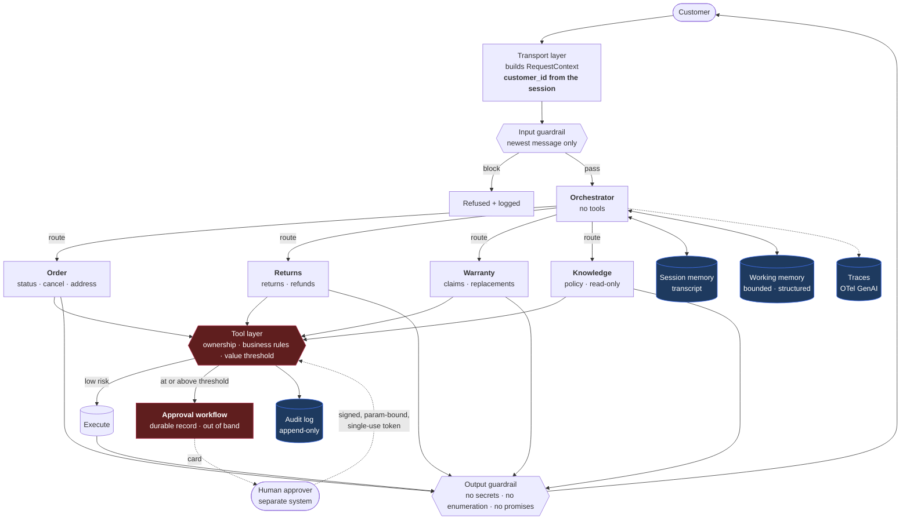

# Architecture



The two red boxes are the only security controls in the picture. Everything
else is quality.

---

## Agents

| Agent | File | Tools | Cannot |
|---|---|---|---|
| **Orchestrator** | `agents/orchestrator.py` | **none** | answer a question |
| **Order** | `agents/specialists.py` | `get_order_status`, `cancel_order`, `change_shipping_address` | refund, touch warranty |
| **Returns** | `agents/specialists.py` | `start_return`, `refund_order` | change an address, dispatch goods |
| **Warranty** | `agents/specialists.py` | `file_warranty_claim`, `dispatch_replacement` | refund |
| **Knowledge** | `agents/specialists.py` | `search_policies` | **any write at all** |

Every "cannot" is enforced by **absence from the tool list**, not by a sentence
in a prompt. No phrasing and no injected instruction can reach a function that
was never passed to the agent.

**The orchestrator holds no tools.** An agent with no tools cannot half-answer
a request and hand over a partially actioned mess; its only job is to decide
who owns the turn.

---

## Request path

```
RequestContext (authenticated)
  └─ input guardrail        — newest message only, before any model call
      └─ route              — classification; falls back to the READ-ONLY agent
          └─ specialist     — bounded tool loop, max 4 iterations
              └─ tool layer — ownership · rules · threshold · approval
                  └─ audit
          └─ output guardrail
              └─ persist    — session + working memory, LAST
```

Two orderings are load-bearing:

**The input guardrail runs before the router.** A blocked message costs nothing
and reaches no model. `self_test.py` asserts that a blocked turn emits no
routing span.

**Persistence happens last.** A blocked turn leaves no residue in working
memory, so a hostile message cannot plant structure that influences later
turns.

---

## Routing

Routing is a model decision constrained by structure, not a classifier
pretending to be a control:

| Mechanism | Effect |
|---|---|
| Per-agent descriptions in the router prompt | the only routing signal |
| Unknown destination → `knowledge` | the fallback is **read-only**, so a bad route cannot write |
| Tool scope | a misroute reaches no tool it should not have |
| Routing-mix alarm | catches silent drift — **no RED metric moves when it happens** |

Because the fallback is read-only and scope is enforced per agent, **routing
accuracy is a quality metric, not a security control.** A warranty question
landing on the Order agent produces an unhelpful answer, not an incident.

---

## Memory

Two tiers, with different jobs.

| | Session (`memory/session.py`) | Working (`memory/working.py`) |
|---|---|---|
| Holds | the transcript — what was *said* | structure — what is *known* |
| Shape | append-only rows | one bounded record |
| Growth | linear | capped (5 orders, 12 facts, 10 intents) |
| Replay | last 12 turns | rendered into the system prompt |
| Eviction | oldest turns dropped | **least-recently-referenced** |

Eviction is LRU rather than FIFO because in a support conversation the order
the customer keeps coming back to is the live one, and FIFO drops exactly that
one in a long thread.

**A pending approval lives in the durable approval table, not in either memory
tier.** An approver may act tomorrow. If the pending change sat in session
state, an expiry or a redeploy would silently lose it and the customer would
be waiting on a request that no longer exists.

---

## Observability

Spans follow OpenTelemetry GenAI semantic conventions (`gen_ai.request.model`,
`gen_ai.usage.*`), written as JSONL so the repository runs with no collector.
Swapping in an OTLP exporter is a transport change.

Two recordings that are easy to omit:

- **Guardrail allows, not only blocks.** Recording only blocks gives a
  denominator of zero, and the block *rate* is the signal.
- **Routing decisions.** See T9 in the threat model: routing drift improves
  every RED metric while the product degrades.
